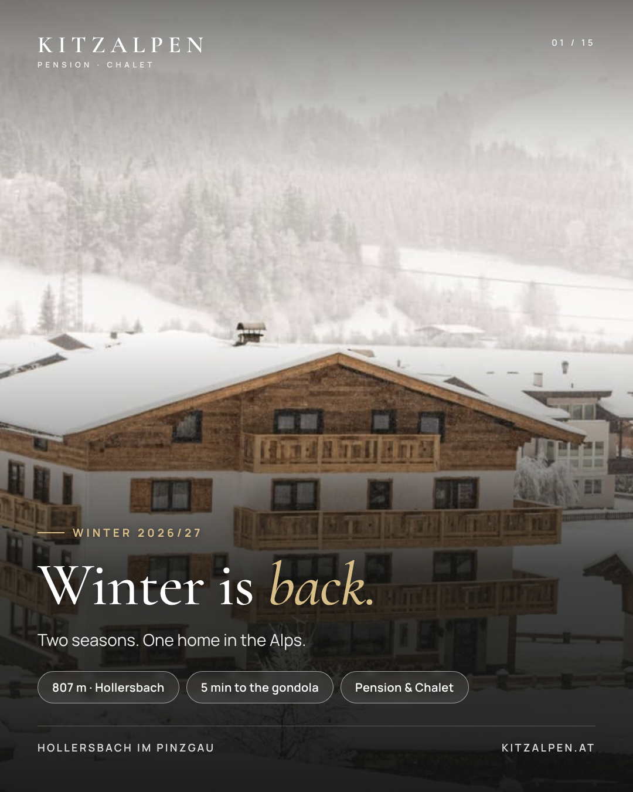
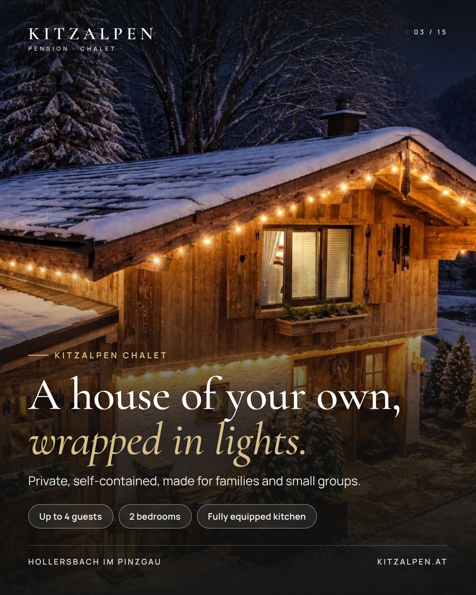
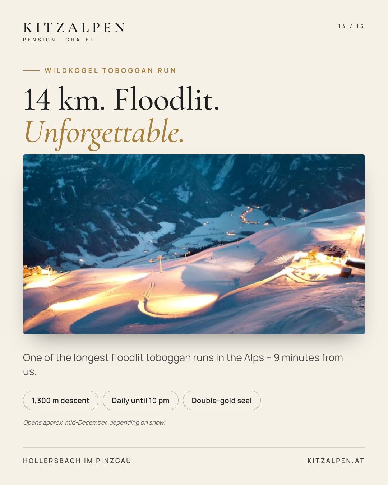
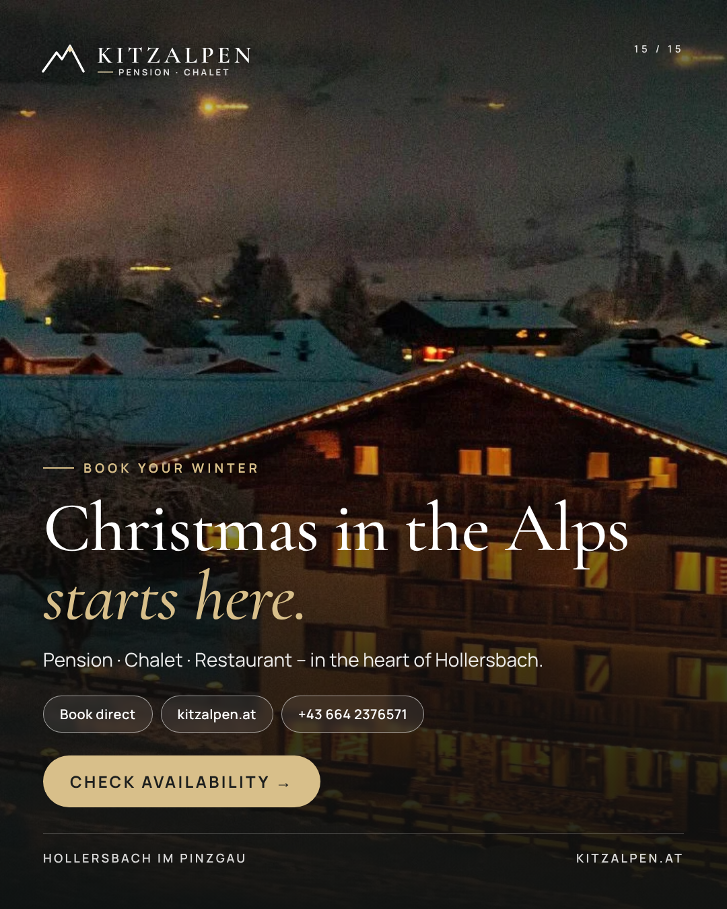

# KitzAlpen – Social-Media-Kalender (17.11. – 15.12.2026)

Alle 2 Tage · 1080×1350 (Instagram/Facebook) · empfohlen 18:00 Uhr · Text: Deutsch, dann Englisch, mit Buchungsdetails

## 01 · Dienstag, 17.11.2026 — Winter is back.



```
🇦🇹 Schnee auf den Dächern, Berge rundherum: Der Winter ist zurück in Hollersbach im Pinzgau – und wir freuen uns auf euch. ❄️ Pension, Chalet und Restaurant, nur fünf Minuten von der KitzSki-Gondel entfernt.

🇬🇧 Snow on the roofs, smoke from the chimneys, mountains all around. Winter is back in Hollersbach im Pinzgau – and so are we. ❄️ Pension, chalet and restaurant, five minutes from the KitzSki gondola.

📅 Jetzt buchen / Book now: kitzalpen.at
📞 +43 664 2376571
✉️ kitzbuhelalpenpension@gmail.com
📍 Reitlehen 42, 5731 Hollersbach im Pinzgau

#KitzAlpen #Hollersbach #Pinzgau #SalzburgerLand #WinterInAustria #AlpineLiving
```

## 02 · Donnerstag, 19.11.2026 — Advent lights, 36 minutes away.


```
🇦🇹 Der Kitzbüheler Advent hat begonnen! ✨ Bummelt durch die mittelalterliche Vorder- und Hinterstadt, wärmt euch die Hände an einer Tasse Punsch und lasst die Lichter wirken. Nur 36 Minuten von KitzAlpen entfernt. Geöffnet bis 27. Dezember.

🇬🇧 Kitzbühel Advent has started! ✨ Wander the medieval Vorderstadt and Hinterstadt, warm your hands on a mug of punch and let the lights do the rest. Only 36 minutes from KitzAlpen. Open until 27 December.

📅 Jetzt buchen / Book now: kitzalpen.at
📞 +43 664 2376571
✉️ kitzbuhelalpenpension@gmail.com
📍 Reitlehen 42, 5731 Hollersbach im Pinzgau

#KitzbühelAdvent #Kitzbühel #ChristmasMarket #Adventmarkt #KitzAlpen #Tirol
```

## 03 · Samstag, 21.11.2026 — A house of your own, wrapped in lights.



```
🇦🇹 Lichterketten, Altholz und eine Tür, die nur euch gehört. 🏡 Unser KitzAlpen Chalet bietet Platz für bis zu 4 Personen – zwei Schlafzimmer, eine voll ausgestattete Küche und einen gemütlichen Wohnbereich für entspannte Abende nach dem Skitag.

🇬🇧 Fairy lights, reclaimed wood and a door that's only yours. 🏡 Our KitzAlpen Chalet sleeps up to 4 – two bedrooms, a full kitchen and a cosy living area for slow evenings after a day on the slopes.

📅 Jetzt buchen / Book now: kitzalpen.at
📞 +43 664 2376571
✉️ kitzbuhelalpenpension@gmail.com
📍 Reitlehen 42, 5731 Hollersbach im Pinzgau

#KitzAlpenChalet #ChaletLife #AlpineChalet #FamilyHoliday #Hollersbach #CosyVibes
```

## 04 · Montag, 23.11.2026 — Cast iron. Pure Pinzgau.


```
🇦🇹 Geschmortes Rindfleisch mit Paprika, direkt aus der Pfanne auf euren Tisch. 🍷 Unsere Küche serviert hausgemachte, regionale Gerichte – Dienstag bis Sonntag, 17 bis 21 Uhr. Schon Hunger?

🇬🇧 Braised beef with peppers, straight from the pan to your table. 🍷 Our kitchen serves home-made, regional dishes every evening Tuesday to Sunday, 5–9 pm. Hungry yet?

📅 Jetzt buchen / Book now: kitzalpen.at
📞 +43 664 2376571
✉️ kitzbuhelalpenpension@gmail.com
📍 Reitlehen 42, 5731 Hollersbach im Pinzgau

#KitzAlpenRestaurant #AustrianFood #Foodie #Pinzgau #AlpineCuisine #DinnerTime
```

## 05 · Mittwoch, 25.11.2026 — Skiing at 3,029 m. Already.


```
🇦🇹 Ihr könnt nicht bis Dezember warten? Müsst ihr auch nicht. 🏔️ Der Kitzsteinhorn-Gletscher in Kaprun ist seit 10. Oktober geöffnet – 61 Pistenkilometer bis auf 3.029 m, dazu die Panoramaplattform TOP OF SALZBURG für Nicht-Skifahrer. 35 Minuten von KitzAlpen.

🇬🇧 Can't wait for December? You don't have to. 🏔️ The Kitzsteinhorn glacier in Kaprun has been open since 10 October – 61 km of slopes up to 3,029 m, plus the TOP OF SALZBURG panorama platform for non-skiers. 35 minutes from KitzAlpen.

📅 Jetzt buchen / Book now: kitzalpen.at
📞 +43 664 2376571
✉️ kitzbuhelalpenpension@gmail.com
📍 Reitlehen 42, 5731 Hollersbach im Pinzgau

#Kitzsteinhorn #Kaprun #GlacierSkiing #SkiAustria #TopOfSalzburg #KitzAlpen
```

## 06 · Freitag, 27.11.2026 — Après-ski, the cosy way.


```
🇦🇹 Das Schönste an einem Skitag? Sein Ausklang. 🥂 Altholz, Schaffellhocker, warmes Licht und ein frisch gezapftes Glas an unserer Bar. Markiert die Person, mit der ihr eine Runde teilen würdet.

🇬🇧 The best part of a ski day? The end of it. 🥂 Reclaimed wood, sheepskin stools, warm light and a freshly poured glass at our bar. Tag the person you'd share a round with.

📅 Jetzt buchen / Book now: kitzalpen.at
📞 +43 664 2376571
✉️ kitzbuhelalpenpension@gmail.com
📍 Reitlehen 42, 5731 Hollersbach im Pinzgau

#ApresSki #KitzAlpen #AlpineBar #CosyEvenings #WinterVibes #Austria
```

## 07 · Sonntag, 29.11.2026 — Leave the car. Trains & buses included.


```
🇦🇹 Gut zu wissen: Seit Mai 2025 erhält jeder Übernachtungsgast im Land Salzburg beim Check-in das Gäste-Mobilitätsticket – alle Busse, S-Bahnen sowie Regional- und Fernzüge im ganzen Bundesland inklusive. 🚆 Dazu die M+ Gästekarte für Mittersill, Hollersbach und Stuhlfelden.

🇬🇧 Good to know: since May 2025 every overnight guest in Salzburg gets the Guest Mobility Ticket at check-in – all buses, S-Bahn and regional & long-distance trains across the state, included. 🚆 Plus the M+ Guest Card for Mittersill, Hollersbach & Stuhlfelden.

📅 Jetzt buchen / Book now: kitzalpen.at
📞 +43 664 2376571
✉️ kitzbuhelalpenpension@gmail.com
📍 Reitlehen 42, 5731 Hollersbach im Pinzgau

#GuestMobilityTicket #SalzburgerLand #SustainableTravel #KitzAlpen #CarFreeHoliday
```

## 08 · Dienstag, 01.12.2026 — 871 km of slopes. One home.


```
🇦🇹 Hallo Dezember! 🎿 Sechs Skigebiete, 871 Pistenkilometer – und wir mittendrin. KitzSki 5 Min., Wildkogel 9, Zillertal Arena 34, Kitzsteinhorn 35, Schmittenhöhe 37, SkiWelt 51. Welches steht bei euch ganz oben auf der Liste?

🇬🇧 Hello December! 🎿 Six ski areas, 871 km of slopes – and we're right in the middle. KitzSki 5 min, Wildkogel 9 min, Zillertal Arena 34, Kitzsteinhorn 35, Schmittenhöhe 37, SkiWelt 51. Which one is first on your list?

📅 Jetzt buchen / Book now: kitzalpen.at
📞 +43 664 2376571
✉️ kitzbuhelalpenpension@gmail.com
📍 Reitlehen 42, 5731 Hollersbach im Pinzgau

#SkiAustria #KitzSki #Wildkogel #ZillertalArena #Schmittenhöhe #SkiWelt #KitzAlpen
```

## 09 · Donnerstag, 03.12.2026 — The countdown is over.


```
🇦🇹 Diese Woche ist es so weit! ⛷️ Schmittenhöhe und Zillertal Arena starten am 4. Dezember, Wildkogel und SkiWelt am 5. Dezember, die komplette KitzSki-Skischaukel am 11. Dezember. Ski schon gewachst? (Geplante Termine, abhängig von Schnee und Wetter.)

🇬🇧 This is the week! ⛷️ Schmittenhöhe and the Zillertal Arena open on 4 December, Wildkogel and SkiWelt on 5 December, and the full KitzSki circuit on 11 December. Skis waxed? (Planned dates, depending on snow and weather.)

📅 Jetzt buchen / Book now: kitzalpen.at
📞 +43 664 2376571
✉️ kitzbuhelalpenpension@gmail.com
📍 Reitlehen 42, 5731 Hollersbach im Pinzgau

#SeasonOpening #SkiOpening #SkiAustria #Powder #KitzAlpen #Pinzgau
```

## 10 · Samstag, 05.12.2026 — Wood, warmth & a good night's sleep.


```
🇦🇹 Rein ins Warme. 🛏️ 17 Zimmer in vier Kategorien – Doppel-, Dreibett-, Vierbett- und Familienzimmer mit Verbindungstür – viel Holz, warmes Licht und ein Skiraum mit Schuhtrocknern.

🇬🇧 Come in from the cold. 🛏️ 17 rooms in four categories – double, triple, quad and family rooms with connecting door – plenty of wood, warm light and a ski room with boot dryers downstairs.

📅 Jetzt buchen / Book now: kitzalpen.at
📞 +43 664 2376571
✉️ kitzbuhelalpenpension@gmail.com
📍 Reitlehen 42, 5731 Hollersbach im Pinzgau

#KitzAlpenPension #AlpineRooms #FamilyRoom #Hollersbach #SkiHoliday #CosyRoom
```

## 11 · Montag, 07.12.2026 — 12 pools. 10 saunas. Zero worries.


```
🇦🇹 Ruhetag? Dann aber richtig. 💦 Tauern Spa in Kaprun: 20.000 m² Wasser- und Saunawelt, 12 Becken, 10 Saunen und Dampfbäder, mit Blick aufs Kitzsteinhorn. 27 Minuten von KitzAlpen.

🇬🇧 Rest day? Make it a good one. 💦 Tauern Spa in Kaprun: 20,000 m² of pools and saunas, 12 pools, 10 saunas and steam baths, panoramic views of the Kitzsteinhorn. 27 minutes from KitzAlpen.

📅 Jetzt buchen / Book now: kitzalpen.at
📞 +43 664 2376571
✉️ kitzbuhelalpenpension@gmail.com
📍 Reitlehen 42, 5731 Hollersbach im Pinzgau

#TauernSpa #Kaprun #Wellness #SpaDay #RestDay #KitzAlpen
```

## 12 · Mittwoch, 09.12.2026 — Frozen in time.


```
🇦🇹 Eine Eisskulptur der Natur. 🧊 Bei einer geführten Schneeschuhwanderung mit dem Nationalpark-Ranger seht ihr die Krimmler Wasserfälle im Wintereis. Kostenlos mit Gästekarte oder WinterCard, 23 Minuten von KitzAlpen. (Programm 2026/27 folgt – letzten Winter: montags ab Ende Dezember.)

🇬🇧 Nature's own ice sculpture. 🧊 On a ranger-led snowshoe hike you'll see the Krimml Waterfalls hung with winter ice. Free with the guest card or WinterCard, 23 minutes from KitzAlpen. (2026/27 programme to be announced – last winter: Mondays from late December.)

📅 Jetzt buchen / Book now: kitzalpen.at
📞 +43 664 2376571
✉️ kitzbuhelalpenpension@gmail.com
📍 Reitlehen 42, 5731 Hollersbach im Pinzgau

#KrimmlWaterfalls #Krimml #HoheTauern #Snowshoeing #NationalPark #KitzAlpen
```

## 13 · Freitag, 11.12.2026 — 233 km. Fully connected.


```
🇦🇹 Es ist so weit! 🚠 Ab heute ist die komplette KitzSki-Skischaukel offen – vom Hahnenkamm bis zur Resterhöhe, 233 km und 58 Lifte. Unsere Abkürzung: die Panoramabahn in Hollersbach, nur 5 Minuten von KitzAlpen.

🇬🇧 It's here! 🚠 From today the full KitzSki circuit is open – Hahnenkamm to Resterhöhe, 233 km and 58 lifts. Our shortcut: the Panoramabahn in Hollersbach, just 5 minutes from KitzAlpen.

📅 Jetzt buchen / Book now: kitzalpen.at
📞 +43 664 2376571
✉️ kitzbuhelalpenpension@gmail.com
📍 Reitlehen 42, 5731 Hollersbach im Pinzgau

#KitzSki #Kitzbühel #Hahnenkamm #Panoramabahn #SkiDay #KitzAlpen
```

## 14 · Sonntag, 13.12.2026 — 14 km. Floodlit. Unforgettable.



```
🇦🇹 14 km, 1.300 Höhenmeter und Licht bis ins Tal. 🛷 Die Rodelbahn am Wildkogel in Bramberg ist täglich bis 22 Uhr beleuchtet (montags bis 18 Uhr) – 9 Minuten von KitzAlpen. Start etwa Mitte Dezember, je nach Schneelage.

🇬🇧 14 km, 1,300 vertical metres and lights all the way down. 🛷 The Wildkogel toboggan run in Bramberg is floodlit daily until 10 pm (Mon until 6 pm) – 9 minutes from KitzAlpen. Opens around mid-December, snow permitting.

📅 Jetzt buchen / Book now: kitzalpen.at
📞 +43 664 2376571
✉️ kitzbuhelalpenpension@gmail.com
📍 Reitlehen 42, 5731 Hollersbach im Pinzgau

#Wildkogel #Tobogganing #Rodeln #NightSledding #FamilyFun #KitzAlpen
```

## 15 · Dienstag, 15.12.2026 — Christmas in the Alps starts here.



```
🇦🇹 Die Lichter brennen, die Pisten sind offen, der Baum steht. 🎄 Verbringt Weihnachten und Silvester bei uns in Hollersbach – im Zimmer in der Pension oder im eigenen Chalet. Jetzt direkt buchen auf kitzalpen.at.

🇬🇧 The lights are on, the slopes are open and the tree is up. 🎄 Spend Christmas and New Year with us in Hollersbach – a room in the pension or your own chalet. Book directly at kitzalpen.at.

📅 Jetzt buchen / Book now: kitzalpen.at
📞 +43 664 2376571
✉️ kitzbuhelalpenpension@gmail.com
📍 Reitlehen 42, 5731 Hollersbach im Pinzgau

#ChristmasInTheAlps #WinterHoliday #KitzAlpen #Hollersbach #NewYearInAustria #BookDirect
```
