# KitzAlpen – calendar social media (17 nov – 15 dec 2026)

Frecvență: o dată la 2 zile · format 1080×1350 (Instagram/Facebook feed) · ora recomandată: 18:00
Sursa pozelor și informațiilor: kitzalpen.at

## 01 · Marți, 17.11.2026 — Winter is back.

**Temă:** Winter 2026/27

**EN:** Snow on the roofs, smoke from the chimneys, mountains all around. Winter is back in Hollersbach im Pinzgau – and so are we. ❄️ Pension, chalet and restaurant, five minutes from the KitzSki gondola.

**RO:** Zăpadă pe acoperișuri, munți de jur împrejur. Iarna s-a întors în Hollersbach im Pinzgau – și noi te așteptăm. ❄️ Pensiune, chalet și restaurant, la 5 minute de telegondola KitzSki.

#KitzAlpen #Hollersbach #Pinzgau #SalzburgerLand #WinterInAustria #AlpineLiving

## 02 · Joi, 19.11.2026 — Advent lights, 36 minutes away.

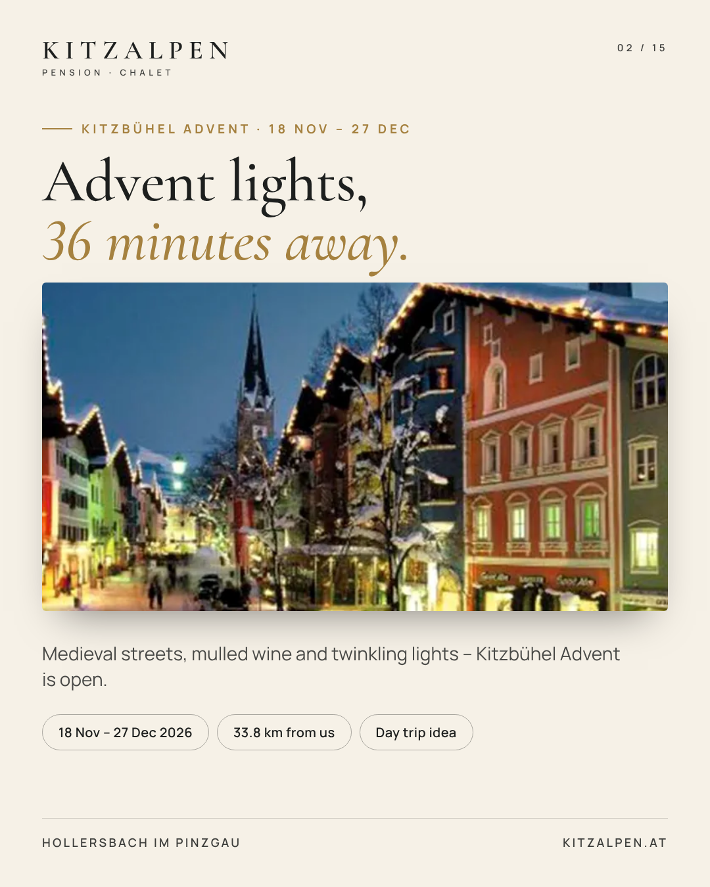

**Temă:** Kitzbühel Advent · 18 Nov – 27 Dec

**EN:** Kitzbühel Advent has started! ✨ Wander the medieval Vorderstadt and Hinterstadt, warm your hands on a mug of punch and let the lights do the rest. Only 36 minutes from KitzAlpen. Open until 27 December.

**RO:** A început Adventul în Kitzbühel! ✨ Străduțe medievale, vin fiert și lumini peste tot. La doar 36 de minute de KitzAlpen. Deschis până pe 27 decembrie.

#KitzbühelAdvent #Kitzbühel #ChristmasMarket #Adventmarkt #KitzAlpen #Tirol

## 03 · Sâmbătă, 21.11.2026 — A house of your own, wrapped in lights.

**Temă:** KitzAlpen Chalet

**EN:** Fairy lights, reclaimed wood and a door that's only yours. 🏡 Our KitzAlpen Chalet sleeps up to 4 – two bedrooms, a full kitchen and a cosy living area for slow evenings after a day on the slopes.

**RO:** Lumini calde, lemn vechi și o ușă doar a ta. 🏡 KitzAlpen Chalet – pentru până la 4 persoane, 2 dormitoare, bucătărie complet utilată și living cozy pentru serile de după pârtie.

#KitzAlpenChalet #ChaletLife #AlpineChalet #FamilyHoliday #Hollersbach #CosyVibes

## 04 · Luni, 23.11.2026 — Cast iron. Pure Pinzgau.

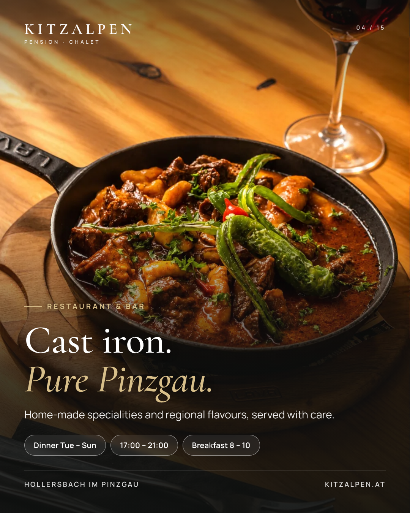

**Temă:** Restaurant & Bar

**EN:** Braised beef with peppers, straight from the pan to your table. 🍷 Our kitchen serves home-made, regional dishes every evening Tuesday to Sunday, 5–9 pm. Hungry yet?

**RO:** Vită înăbușită cu ardei, direct din tigaia de fontă pe masa ta. 🍷 Bucătărie de casă, regională, în fiecare seară de marți până duminică, 17–21. Ți s-a făcut foame?

#KitzAlpenRestaurant #AustrianFood #Foodie #Pinzgau #AlpineCuisine #DinnerTime

## 05 · Miercuri, 25.11.2026 — Skiing at 3,029 m. Already.

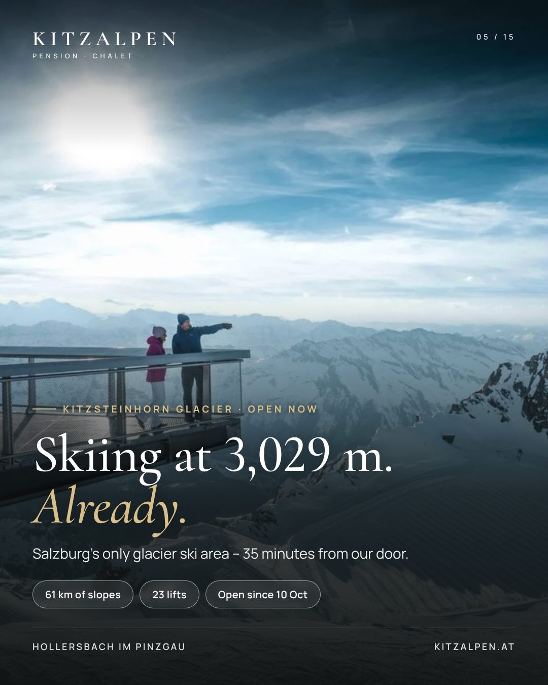

**Temă:** Kitzsteinhorn glacier · open now

**EN:** Can't wait for December? You don't have to. 🏔️ The Kitzsteinhorn glacier in Kaprun has been open since 10 October – 61 km of slopes up to 3,029 m, plus the TOP OF SALZBURG panorama platform for non-skiers. 35 minutes from KitzAlpen.

**RO:** Nu mai poți aștepta până în decembrie? Nici nu trebuie. 🏔️ Ghețarul Kitzsteinhorn din Kaprun e deschis din 10 octombrie – 61 km de pârtii până la 3.029 m, plus platforma panoramică TOP OF SALZBURG. La 35 de minute de KitzAlpen.

#Kitzsteinhorn #Kaprun #GlacierSkiing #SkiAustria #TopOfSalzburg #KitzAlpen

## 06 · Vineri, 27.11.2026 — Après-ski, the cosy way.

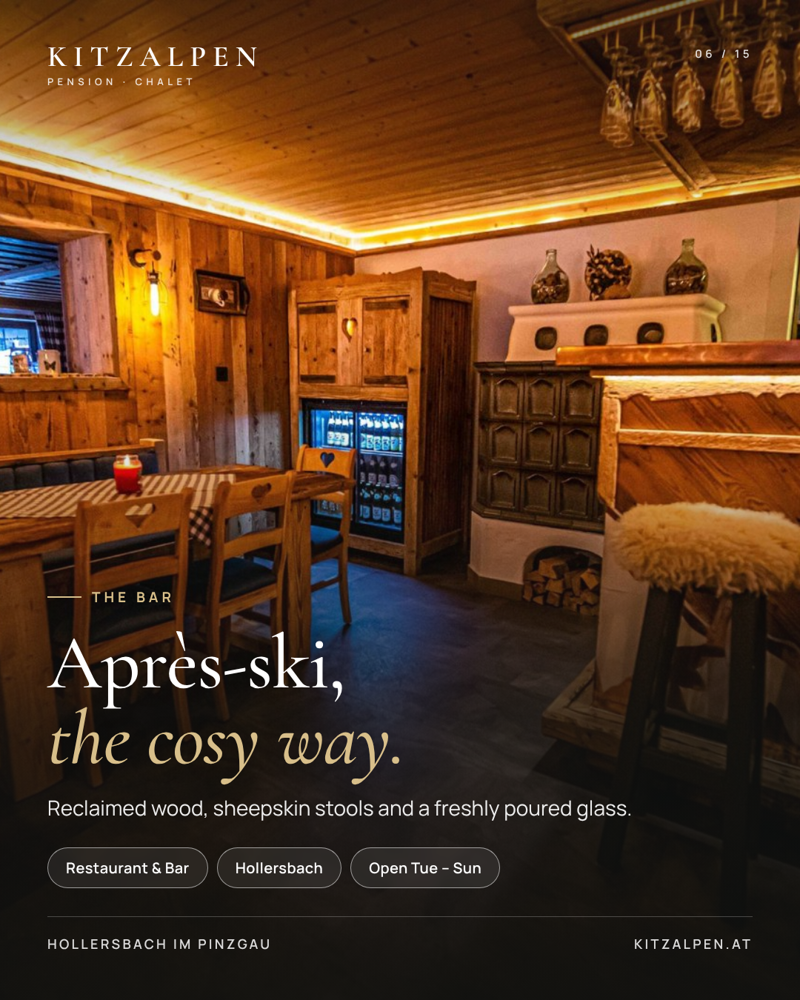

**Temă:** The Bar

**EN:** The best part of a ski day? The end of it. 🥂 Reclaimed wood, sheepskin stools, warm light and a freshly poured glass at our bar. Tag the person you'd share a round with.

**RO:** Cea mai bună parte a unei zile de schi? Finalul ei. 🥂 Lemn vechi, scaune cu blană, lumină caldă și un pahar proaspăt turnat la barul nostru. Dă tag cuiva cu care ai bea un rând.

#ApresSki #KitzAlpen #AlpineBar #CosyEvenings #WinterVibes #Austria

## 07 · Duminică, 29.11.2026 — Leave the car. Trains & buses included.

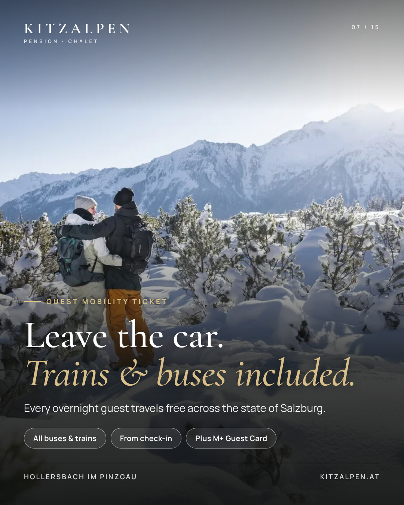

**Temă:** Guest Mobility Ticket

**EN:** Good to know: since May 2025 every overnight guest in Salzburg gets the Guest Mobility Ticket at check-in – all buses, S-Bahn and regional & long-distance trains across the state, included. 🚆 Plus the M+ Guest Card for Mittersill, Hollersbach & Stuhlfelden.

**RO:** Bine de știut: din mai 2025, fiecare oaspete cazat în Salzburg primește la check-in Guest Mobility Ticket – toate autobuzele și trenurile din landul Salzburg, incluse. 🚆 Plus cardul M+ pentru Mittersill, Hollersbach și Stuhlfelden.

#GuestMobilityTicket #SalzburgerLand #SustainableTravel #KitzAlpen #CarFreeHoliday

## 08 · Marți, 01.12.2026 — 871 km of slopes. One home.

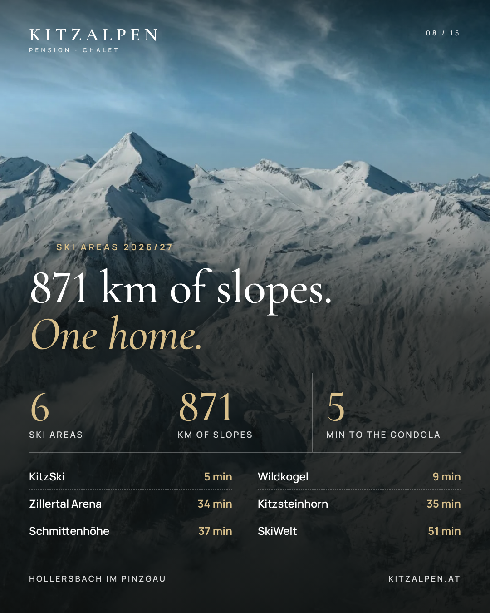

**Temă:** Ski areas 2026/27

**EN:** Hello December! 🎿 Six ski areas, 871 km of slopes – and we're right in the middle. KitzSki 5 min, Wildkogel 9 min, Zillertal Arena 34, Kitzsteinhorn 35, Schmittenhöhe 37, SkiWelt 51. Which one is first on your list?

**RO:** Bun venit, decembrie! 🎿 Șase domenii schiabile, 871 km de pârtii – iar noi suntem chiar la mijloc. KitzSki 5 min, Wildkogel 9 min, Zillertal Arena 34, Kitzsteinhorn 35, Schmittenhöhe 37, SkiWelt 51. Pe care îl alegi primul?

#SkiAustria #KitzSki #Wildkogel #ZillertalArena #Schmittenhöhe #SkiWelt #KitzAlpen

## 09 · Joi, 03.12.2026 — The countdown is over.

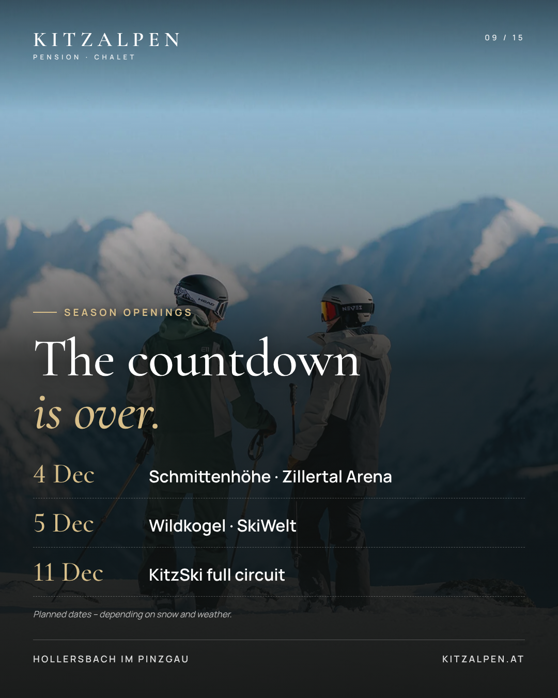

**Temă:** Season openings

**EN:** This is the week! ⛷️ Schmittenhöhe and the Zillertal Arena open on 4 December, Wildkogel and SkiWelt on 5 December, and the full KitzSki circuit on 11 December. Skis waxed? (Planned dates, depending on snow and weather.)

**RO:** Asta e săptămâna! ⛷️ Schmittenhöhe și Zillertal Arena se deschid pe 4 decembrie, Wildkogel și SkiWelt pe 5 decembrie, iar circuitul complet KitzSki pe 11 decembrie. Schiurile sunt pregătite? (Date planificate, în funcție de zăpadă și vreme.)

#SeasonOpening #SkiOpening #SkiAustria #Powder #KitzAlpen #Pinzgau

## 10 · Sâmbătă, 05.12.2026 — Wood, warmth & a good night's sleep.

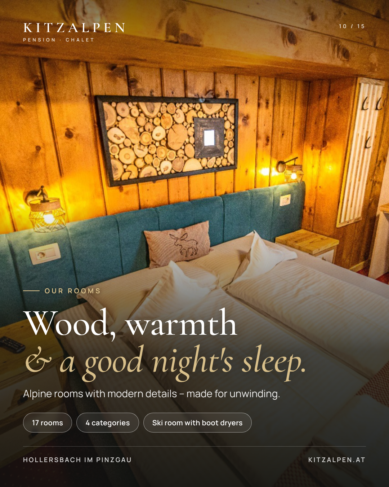

**Temă:** Our rooms

**EN:** Come in from the cold. 🛏️ 17 rooms in four categories – double, triple, quad and family rooms with connecting door – plenty of wood, warm light and a ski room with boot dryers downstairs.

**RO:** Intră de la frig. 🛏️ 17 camere în patru categorii – duble, triple, cvadruple și de familie cu ușă comunicantă – mult lemn, lumină caldă și cameră de schiuri cu uscătoare de clăpari.

#KitzAlpenPension #AlpineRooms #FamilyRoom #Hollersbach #SkiHoliday #CosyRoom

## 11 · Luni, 07.12.2026 — 12 pools. 10 saunas. Zero worries.

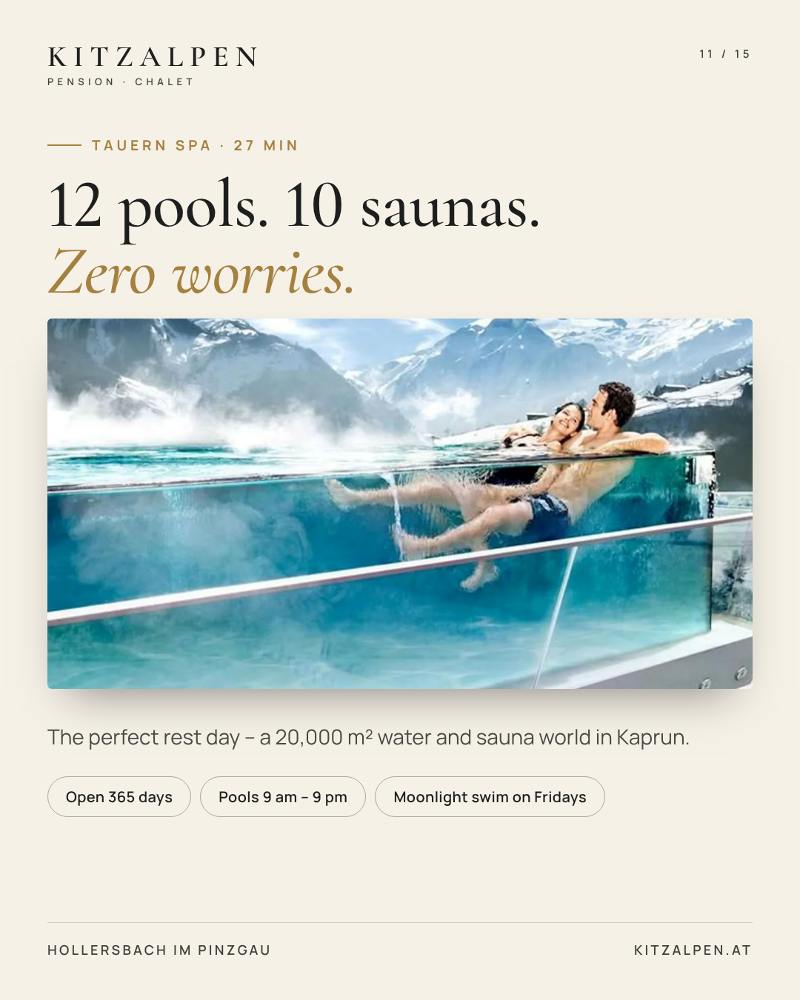

**Temă:** Tauern Spa · 27 min

**EN:** Rest day? Make it a good one. 💦 Tauern Spa in Kaprun: 20,000 m² of pools and saunas, 12 pools, 10 saunas and steam baths, panoramic views of the Kitzsteinhorn. 27 minutes from KitzAlpen.

**RO:** Zi de pauză? Fă-o memorabilă. 💦 Tauern Spa Kaprun: 20.000 m² de piscine și saune, 12 piscine, 10 saune și băi de aburi, cu priveliște spre Kitzsteinhorn. La 27 de minute de KitzAlpen.

#TauernSpa #Kaprun #Wellness #SpaDay #RestDay #KitzAlpen

## 12 · Miercuri, 09.12.2026 — Frozen in time.

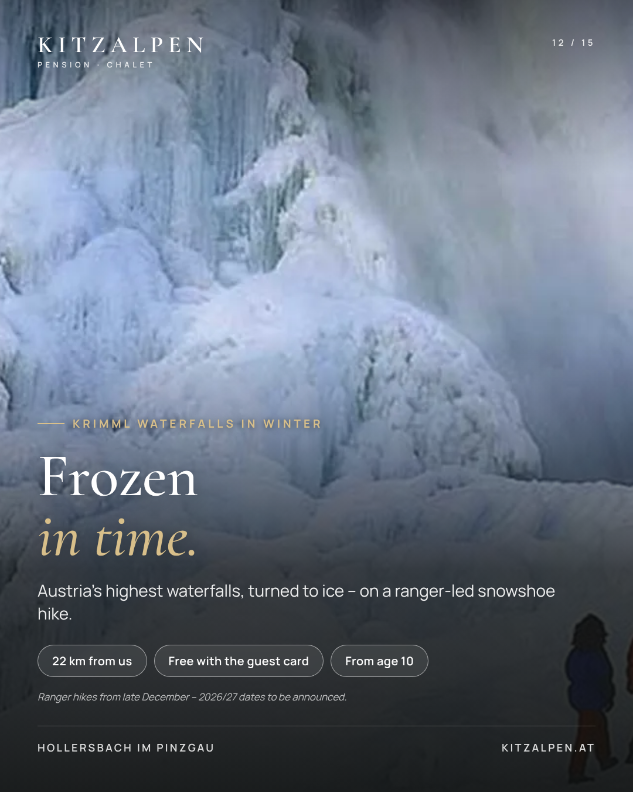

**Temă:** Krimml Waterfalls in winter

**EN:** Nature's own ice sculpture. 🧊 On a ranger-led snowshoe hike you'll see the Krimml Waterfalls hung with winter ice. Free with the guest card or WinterCard, 23 minutes from KitzAlpen. (2026/27 programme to be announced – last winter: Mondays from late December.)

**RO:** O sculptură de gheață făcută de natură. 🧊 Într-o drumeție cu rachete de zăpadă alături de un ranger vezi Cascadele Krimml înghețate. Gratuit cu cardul de oaspete sau WinterCard, la 23 de minute de KitzAlpen. (Programul 2026/27 urmează să fie anunțat.)

#KrimmlWaterfalls #Krimml #HoheTauern #Snowshoeing #NationalPark #KitzAlpen

## 13 · Vineri, 11.12.2026 — 233 km. Fully connected.

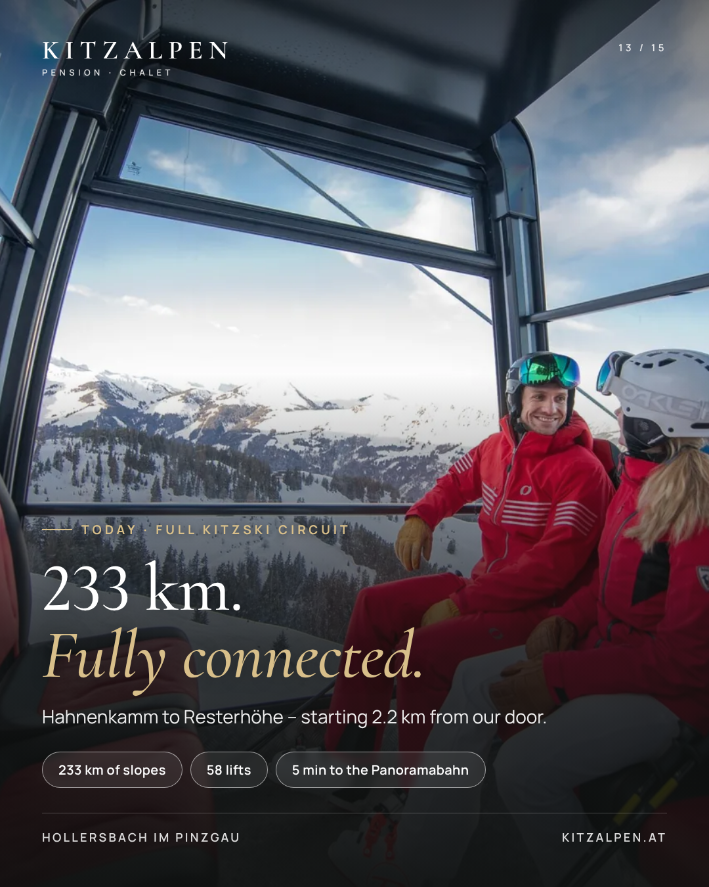

**Temă:** Today · full KitzSki circuit

**EN:** It's here! 🚠 From today the full KitzSki circuit is open – Hahnenkamm to Resterhöhe, 233 km and 58 lifts. Our shortcut: the Panoramabahn in Hollersbach, just 5 minutes from KitzAlpen.

**RO:** A sosit ziua! 🚠 De azi circuitul complet KitzSki e deschis – de la Hahnenkamm la Resterhöhe, 233 km și 58 de instalații. Scurtătura noastră: Panoramabahn din Hollersbach, la 5 minute de KitzAlpen.

#KitzSki #Kitzbühel #Hahnenkamm #Panoramabahn #SkiDay #KitzAlpen

## 14 · Duminică, 13.12.2026 — 14 km. Floodlit. Unforgettable.

**Temă:** Wildkogel toboggan run

**EN:** 14 km, 1,300 vertical metres and lights all the way down. 🛷 The Wildkogel toboggan run in Bramberg is floodlit daily until 10 pm (Mon until 6 pm) – 9 minutes from KitzAlpen. Opens around mid-December, snow permitting.

**RO:** 14 km, 1.300 m diferență de nivel și lumini până jos. 🛷 Pârtia de sanie Wildkogel din Bramberg e iluminată zilnic până la 22:00 (luni până la 18:00) – la 9 minute de KitzAlpen. Se deschide pe la jumătatea lui decembrie, dacă e zăpadă.

#Wildkogel #Tobogganing #Rodeln #NightSledding #FamilyFun #KitzAlpen

## 15 · Marți, 15.12.2026 — Christmas in the Alps starts here.

**Temă:** Book your winter

**EN:** The lights are on, the slopes are open and the tree is up. 🎄 Spend Christmas and New Year with us in Hollersbach – a room in the pension or your own chalet. Book directly at kitzalpen.at.

**RO:** Luminile sunt aprinse, pârtiile deschise, bradul e împodobit. 🎄 Petrece Crăciunul și Revelionul cu noi în Hollersbach – o cameră în pensiune sau propriul tău chalet. Rezervă direct pe kitzalpen.at.

#ChristmasInTheAlps #WinterHoliday #KitzAlpen #Hollersbach #NewYearInAustria #BookDirect
